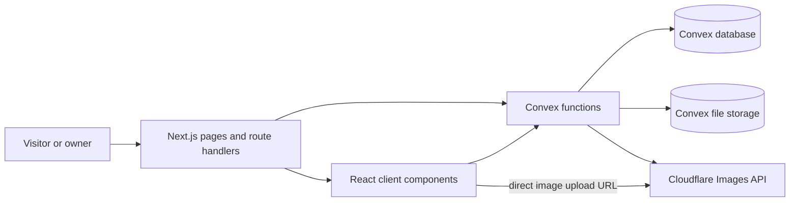
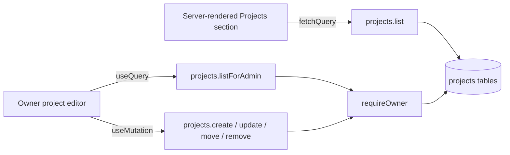
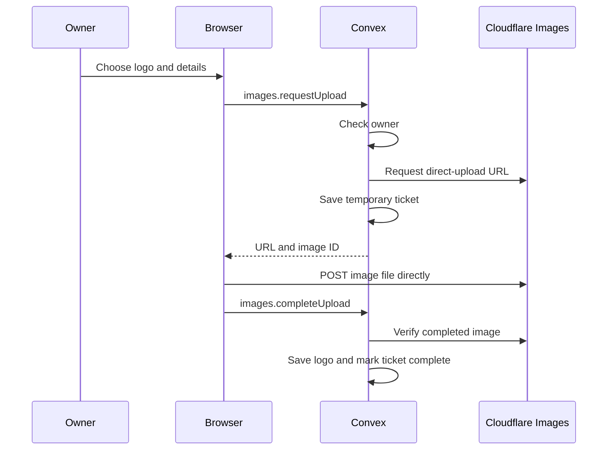

# Christian Valdez's personal site

Next.js 16, React 19, TypeScript 7, Tailwind 4, Convex, and Convex Auth. Cloudflare Images hosts logos. This guide covers both local setup and the patterns used across the current app.

**Quick map:** Next.js renders routes and handles the résumé response; Convex owns persistent data, authentication, and backend rules; React client components handle interaction. Jump to [architecture](#architecture-at-a-glance), [retrieval](#retrieval-pattern), [forms](#forms-and-writes), or [images and files](#image-and-file-flows).

## Setup

Use Node 24 and the pnpm version in package.json. On Windows or macOS, open Warp or your usual terminal in the app folder:

```sh
cd chvaldez10
corepack enable
pnpm install --frozen-lockfile
```

Skip cd if already in the app folder. Copy .env.example to .env.local using your editor; keep an existing .env.local. Convex setup fills in CONVEX_DEPLOYMENT and NEXT_PUBLIC_CONVEX_URL.

```sh
pnpm run doctor
pnpm dev
```

Open http://localhost:3000. One runner starts Next and the Convex development watcher. dev:web and dev:backend also work separately. Starting the backend watcher updates the selected cloud development deployment; routine checks do not.

Cloudflare's API token and auth secrets belong in the Convex deployment settings. Never put them in NEXT_PUBLIC_ variables.

For owner account setup, follow [the short Convex guide](docs/convex-migration/README.md).

## Commands

| Command          | Purpose                                                     |
| ---------------- | ----------------------------------------------------------- |
| pnpm run doctor  | Check versions and configuration without displaying secrets |
| pnpm dev         | Start Next and Convex development together                  |
| pnpm dev:web     | Start Next only                                             |
| pnpm dev:backend | Start the Convex development watcher only                   |
| pnpm check       | Typecheck, lint, formatting, and unit/backend tests         |
| pnpm format      | Format the maintained files in .format-files.json           |
| pnpm test        | Run Node validation tests and Convex backend tests          |
| pnpm build       | Build using the selected environment                        |
| pnpm test:e2e    | Build real pages against a test-only local backend          |

Before the first browser test:

```sh
pnpm exec playwright install chromium
pnpm test:e2e
```

Browser tests start a temporary HTTP backend stub and exercise the real pages, including login errors and private-route protection. Fixtures are used only by tests; the app always uses its configured Convex deployment. CI never deploys. After browser tests, run pnpm build before pnpm start so the build uses your real Convex URL. Live owner login, signout, and direct Cloudflare upload still need acceptance with your privately chosen password.

## Media

The dashboard uploads images directly to Cloudflare using a short-lived upload URL issued after owner authorization. The API token stays on the backend. Convex confirms the upload before saving the logo record.

Résumé links use /api/resume, which serves the PDF from Convex and falls back to /docs/resume.pdf if it is unavailable. Keep public/docs/resume.pdf current. Logo failures show an icon while keeping their text and details usable.

## AI shadowboxing

The manual builder at `/hobbies/mma` remains public. Workout generation appears only for the signed-in owner. Add `GEMINI_API_KEY` to `.env.local` and restart Next; set the same server-only variable in Vercel if you want generation on the hosted site. Never use a `NEXT_PUBLIC_` key. The model selector lists only configured Gemini models that the key reports as available. Gemini 3.5 Flash-Lite is the default, with Gemini 3.1 Flash-Lite as another free-tier option. The API route validates requests and generated workouts with Zod, and each regeneration makes another API call. Google sets the actual quota for your project; check [AI Studio rate limits](https://ai.google.dev/gemini-api/docs/rate-limits) if you receive a limit message.

Owner-only coaching audio offers Gemini (with the same server-only key) and Kokoro 82M, which generates speech in your browser without an API key. Choose the current edited workout or the last AI-generated workout, select a model and voice, and preview it before preparing audio. Kokoro loads only when used; its quantized model is about 92 MB on first download and needs enough device memory. Model files and generated clips are cached in that browser. The player combines round introductions, shared technique prompts, and silence into one track before Start; it supports pause, resume, restart, and stop. Prepare up to 12 rounds and 45 minutes. A fresh three-round Gemini workout needs up to five voice requests; previewing adds one. Long pauses inside spoken clips are shortened locally, including previously cached clips; use Prepare again to rebuild the track. Start the track before locking a phone; verify Kokoro generation, background playback, and headset controls on your actual device. The model and voice catalogs are in `src/lib/workouts/audio/models.server.ts` and `src/lib/workouts/audio/kokoro.ts`; Gemini provider code is in `src/lib/workouts/audio/providers/`. The [Gemini TTS guide](https://ai.google.dev/gemini-api/docs/speech-generation) describes Gemini models and voices; the [Kokoro model card](https://huggingface.co/onnx-community/Kokoro-82M-v1.0-ONNX) describes its local model and voices.

The builder starts with one 3-minute skill round. Signed-in owners can name and save a shadowboxing session, then reopen it from the builder or `/dashboard/workouts` to edit and practice. Named plans contain only settings and round text in the existing Convex deployment. New unsaved drafts are kept in this browser; generated audio remains in its browser cache. The dashboard also lets the owner delete old plans.

For a phone check, prepare two one-minute rounds, tap Start, then lock the screen. Listen through the round change and use headphone pause/resume. Unlock and confirm the round and remaining time match the audio. Repeat in iPhone Safari or Android Chrome on the device you will train with.

See the [Convex setup and preview guide](docs/convex-migration/README.md) for the existing deployment workflow.

## Architecture at a glance



| Piece                               | What it does here                                                              | Where to look                       |
| ----------------------------------- | ------------------------------------------------------------------------------ | ----------------------------------- |
| Next.js App Router                  | Routes, layouts, server rendering, and the résumé HTTP route                   | `src/app/`                          |
| React client components             | Interactive forms, dashboard editors, and live Convex queries                  | `src/components/`                   |
| Convex                              | Schema, reads, writes, auth checks, upload coordination, and scheduled cleanup | `convex/`                           |
| Zod                                 | Friendly validation before selected forms submit                               | `src/lib/validation/`               |
| Tailwind, CSS modules, shadcn/Radix | Styling and accessible UI primitives                                           | `src/styles/`, `src/components/ui/` |
| `cn`                                | Combines conditional classes and resolves conflicting Tailwind classes         | `src/lib/utils.ts`                  |

The `@/` import alias points to `src/`; `@convex/` points to `convex/`. Generated references in `convex/_generated/` give frontend calls typed names such as `api.projects.list`.

### How Next.js is used

`src/app/layout.tsx` wraps the app in Convex Auth’s server and client providers. The `(main)` route group adds public navigation and a footer. The `(admin)` route group contains the dashboard. Route groups organize files without adding their names to the URL.

Pages and data helpers can read Convex on the server. For example, the Projects section calls `fetchQuery(api.projects.list, {})` in `src/components/core/hero/Projects.tsx`. It uses `connection()` before the read, then passes the result to a client component. If Convex is unavailable or the section has not yet been imported, it displays the code-defined project cards from `src/constants/projectData.ts`.

Interactive components use `useQuery`, `useMutation`, or `useAction` from `convex/react`. `useQuery` stays subscribed to data changes; a server `fetchQuery` reads for that render. The dashboard project manager uses `"skip"` until authentication is ready:

```tsx
const { isAuthenticated } = useConvexAuth();
const data = useQuery(api.projects.listForAdmin, isAuthenticated ? {} : "skip");
```

The Next route `src/app/api/resume/route.ts` is a small HTTP adapter: it asks Convex for the résumé storage URL, serves a valid PDF, and redirects to `public/docs/resume.pdf` when needed. Most data access goes directly through Convex functions; there is no separate Next API route for each table.

### How Convex is organized

`convex/schema.ts` defines tables, field types, and indexes. Files such as `projects.ts`, `brandLogos.ts`, and `tutoringInquiries.ts` define functions for their feature. A `query` reads data, a `mutation` changes data transactionally, and an `action` calls external services such as Cloudflare. Internal functions support backend workflows and are not browser APIs.

| Data                         | Used for                                           | Read/write boundary                               |
| ---------------------------- | -------------------------------------------------- | ------------------------------------------------- |
| Auth tables                  | Owner account and sessions                         | Convex Auth; owner setup is restricted            |
| `projectSection`, `projects` | Home page copy and project cards                   | Public read; owner write                          |
| `brandLogos`                 | Tech Finds entries and Cloudflare image references | Public active list; owner management              |
| `tutoringInquiries`          | Public requests and follow-up status               | Public submit; owner read and manage              |
| `pendingImages`              | Temporary, owner-bound upload tickets              | Internal functions                                |
| `siteAssets`                 | Résumé storage reference                           | Public résumé URL query; internal file management |
| `featureFlags`               | Legacy imported flags                              | Public signup query currently returns `false`     |

Queries use indexes and bounded reads. For example, `projects.list` reads at most 100 projects by `sortOrder`; `tutoringInquiries.listForOwner` reads the newest 100 for one status through `by_status`. The public Tech Finds list includes active logos; the owner list includes all logos.



The dashboard layout and middleware redirect visitors without owner access to `/login`. The data boundary is inside Convex: protected queries and mutations call `requireOwner` from `convex/permissions.ts`. It resolves the Convex Auth user and checks the email against the deployment’s `OWNER_EMAIL`. Convex Auth password setup requires that email and the owner setup key; public signup is closed.

### Retrieval pattern

Start with a public or owner query in the feature’s Convex file. Give it argument and return validators, use an index for the intended lookup, and bound lists. Call it with `fetchQuery` from server-rendered code or `useQuery` from a client component. `api` references are generated from the exported function names.

```ts
// Condensed from convex/projects.ts
export const list = query({
  args: {},
  returns: result,
  handler: readProjects,
});
```

### Forms and writes

The login, tutoring, and logo forms use React state and `FormData`. They show pending, success, and error states. A form calls a Convex mutation for a database write or an action when an external service is involved.

```mermaid
sequenceDiagram
  participant Visitor
  participant Form as Tutoring form
  participant Convex as tutoringInquiries.submit
  participant DB as Convex database
  Visitor->>Form: Fill and submit
  Form->>Convex: useMutation with form fields
  Convex->>Convex: Validate; check honeypot and rate limits
  Convex->>DB: Insert inquiry with status "new"
  Convex-->>Form: Success or readable error
  Form-->>Visitor: Confirmation or retry message
```

The tutoring form is in `src/components/tutoring/TutoringInquiryDialog.tsx`. HTML field constraints help the visitor, while `convex/tutoringInquiries.ts` validates again before saving. It ignores a filled honeypot and uses the Convex rate limiter component for three submissions per email per day and 60 globally per hour. The owner sees inquiries by status and can update or delete them.

Zod is used where client-side parsing makes a form easier to use, notably login and logo upload. It does **not** replace Convex validators or backend checks. The login form calls `safeParse` to show a useful message before calling Convex Auth. Logo upload validates text and file details in the client; the backend checks the submitted fields and completed image again.

```ts
// Pattern from the login and logo forms
const parsed = loginSchema.safeParse(Object.fromEntries(new FormData(form)));
if (!parsed.success) {
  setError(parsed.error.issues[0].message);
  return;
}
// Use parsed.data for the request.
```

### Image and file flows



This flow keeps the Cloudflare API token in Convex deployment settings. The image bytes go from the browser to Cloudflare, while `brandLogos` stores the display URL and metadata. Completion can be retried safely through the saved ticket. `convex/crons.ts` removes expired tickets hourly. Project image uploads reuse the direct-upload flow before saving a project URL.

The résumé uses a different path: the PDF is in Convex file storage, `siteAssets` points to it, and `/api/resume` serves it. `public/docs/resume.pdf` is the fallback. See [`convex/README.md`](convex/README.md) for the backend function map and media details.

### UI and shared helpers

Tailwind utilities and `src/styles/globals.css` supply the site’s light palette; some larger sections use CSS modules. The existing `src/components/ui/` components wrap Radix primitives and shadcn-style patterns. `class-variance-authority` defines variants for components such as `Button`.

`cn` is a small helper, not a styling system of its own. It runs `clsx` for conditional classes, then `tailwind-merge` so later conflicting Tailwind utilities win:

```tsx
import { cn } from "@/lib/utils";

<div className={cn("rounded-md p-4", selected && "bg-orange-50", className)} />;
```

Use it when a component accepts `className` or has conditional utilities. Plain fixed class strings do not need it.

### Adding a similar feature

1. Put the page or route under `src/app/` and interactive UI under `src/components/`.
2. Add persistent fields and an index in `convex/schema.ts` only if the feature needs new stored data.
3. Add a bounded query or validated mutation in a feature file under `convex/`. Check owner access inside every protected function.
4. Read with `fetchQuery` on the server or `useQuery` in a client component. Write with `useMutation`; use an action for external API calls.
5. Add Zod validation when it improves form feedback. Keep backend validation as the authority.
6. Verify the affected flow, run `pnpm typecheck`, and lint changed code with Oxlint. Do not seed or reset the shared database for routine verification.
