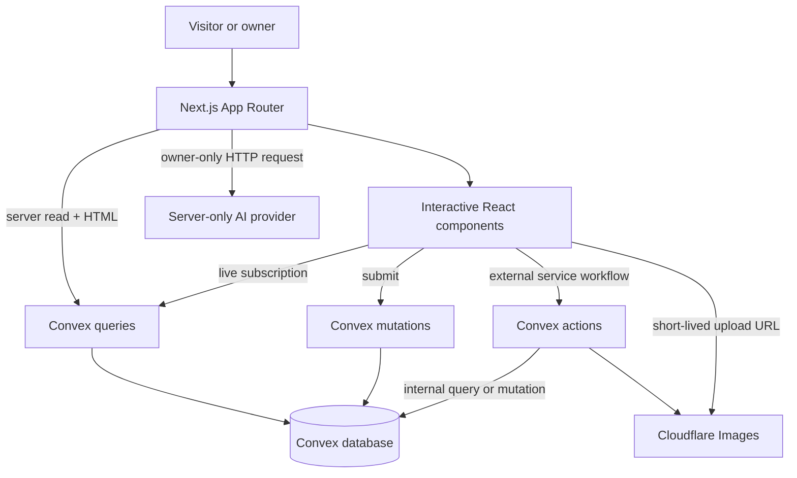

# Next.js + Convex + Tailwind architecture

Use this guide to reproduce the site's architecture in another project: server-rendered pages, reactive data, validated forms, owner access, and reusable UI. Paths are relative to `chvaldez10/`. Examples describe the current app unless marked as an extension.

For agents building another app, reuse the engineering patterns and UX standards. Choose that app's visual identity from its purpose, audience, and design brief: colors, typography, spacing, composition, and motion belong to the new project. This site's branded components and theme are references only.

Start with [the setup recipe](#reproduce-in-another-project), then use [data fetching](#data-fetching), [forms](#forms-and-validation), and [UI conventions](#ui-and-ux-conventions) when adding features. Local commands for this repository remain in the [README](../README.md); backend details live in [convex/README.md](../convex/README.md).

## Responsibilities and request flow



Next.js owns URLs, layouts, rendering, and HTTP-specific responses. Convex owns persistent data, authentication, authorization, and transactional writes. React handles interaction and temporary UI state. Tailwind and local components own presentation. There is no Next API route for every database operation.

| Layer                  | Location                                                       | Responsibility                                                                     |
| ---------------------- | -------------------------------------------------------------- | ---------------------------------------------------------------------------------- |
| Routes and layouts     | `src/app/`                                                     | Server Components by default; public `(main)` and protected `(admin)` route groups |
| Feature UI             | `src/components/dashboard/`, `tutoring/`, `mma/`, `core/hero/` | Forms, editors, presentation, and client subscriptions                             |
| UI primitives          | `src/components/ui/`                                           | Buttons, fields, cards, dialogs, typography                                        |
| Helpers and validation | `src/lib/`                                                     | Zod schemas, server data helpers, URL/file handling, feature logic                 |
| Static content         | `src/constants/`                                               | Navigation, project defaults, code-defined fallback content                        |
| Backend                | `convex/`                                                      | Schema, indexes, feature functions, auth, storage, scheduled work                  |
| Generated contracts    | `convex/_generated/`                                           | Typed `api`, document types, IDs, and function contexts; generated by Convex       |
| Styling                | `src/styles/globals.css`, `*.module.css`                       | Theme tokens and global rules; scoped section styling                              |

Route groups organize layouts without adding `(main)` or `(admin)` to URLs. Keep `"use client"` at interaction boundaries instead of marking whole pages client-side. Passing server-rendered children through the client provider does not turn every child into a Client Component.

## Feature composition

- `ShadowboxingWorkoutBuilder` owns the draft and composes `WorkoutRounds` with the preview and owner controls. `WorkoutRounds` owns pointer interactions and reports edit and reorder intents through typed callbacks. `src/lib/workouts/draft.ts` owns the draft format and pure transformations.
- The home, MMA, and K-pop previews share `useWebGLPreview` and `CanvasBoundary`. Each scene imports its renderer lazily and supplies its own poster, controls, and visibility needs.
- The logo and project editors share file validation and direct upload transport in `src/lib/images/upload.client.ts`. Each editor owns its Convex calls, retry state, and feedback.
- Use these boundaries when adding features. Start with the existing primitives and keep feature state and helpers local until another caller needs the same contract.

## Packages and what each contributes

Version families below describe [package.json](../package.json). The committed `pnpm-lock.yaml` records exact resolutions for this repository; the manifest alone does not reproduce them.

| Package or helper                                     | Role                                                                                     | Example                                             |
| ----------------------------------------------------- | ---------------------------------------------------------------------------------------- | --------------------------------------------------- |
| `next` 16, `react` / `react-dom` 19, `typescript` 7   | App Router, rendering, interaction, static type checking                                 | `src/app/layout.tsx`                                |
| `convex` 1.x                                          | Database, functions, generated types, server reads, live React hooks                     | `convex/projects.ts`                                |
| `@convex-dev/auth`, `@auth/core`                      | Password authentication and session integration with Next.js                             | `convex/auth.ts`, `ConvexClientProvider.tsx`        |
| `tailwindcss` 4, `@tailwindcss/postcss`, `postcss`    | Utility CSS compilation through PostCSS                                                  | `postcss.config.mjs`                                |
| `clsx`                                                | Conditional class strings, arrays, and objects                                           | `src/lib/utils.ts`                                  |
| `tailwind-merge`                                      | Resolves conflicting Tailwind utilities in composed class names                          | `src/lib/utils.ts`                                  |
| `cn`                                                  | Local function composing `clsx` and `tailwind-merge`; no separate package is needed here | `src/lib/utils.ts`                                  |
| `class-variance-authority` (`cva`)                    | Named component variants with TypeScript props                                           | `src/components/ui/buttons/button.tsx`              |
| `@radix-ui/react-dialog`, `react-label`, `react-slot` | Dialog behavior, labels, and `asChild` composition                                       | `src/components/ui/dialog.tsx`                      |
| shadcn-style components                               | Editable source files built on primitives; the existing UI is owned by this repo         | `src/components/ui/`, `components.json`             |
| `zod` 4                                               | Runtime parsing, normalization, validation messages, inferred types                      | `src/lib/validation/`, `src/lib/workouts/schema.ts` |
| `lucide-react`                                        | Consistent UI icons                                                                      | Dashboard and dialog controls                       |
| `tw-animate-css`                                      | CSS animation utilities imported by the global stylesheet                                | `src/styles/globals.css`                            |
| `@convex-dev/rate-limiter`                            | Shared quotas for public inquiries and expensive owner requests                          | `convex/tutoringInquiries.ts`, `convex/admin.ts`    |
| `oxlint`, `prettier`                                  | Linting and formatting                                                                   | Scripts in `package.json`                           |

There is no React Hook Form, TanStack Query, Redux, or separate ORM in this pattern. Native forms plus React state cover the current forms, and Convex hooks already handle reactive server data. Add a library only when a feature needs it. AI/audio, marquee/scroll packages, and legacy Supabase dependencies are feature-specific, not prerequisites for this architecture.

## Reproduce in another project

### 1. Create the app and select versions

Use Node 24 and pnpm 11.20.0 for parity with this repository. In the new project's parent folder:

```sh
pnpm dlx create-next-app@16.3.2 my-app --ts --tailwind --app --src-dir --use-pnpm --import-alias "@/*" --no-linter --react-compiler --yes
cd my-app
corepack use pnpm@11.20.0
pnpm add --save-exact next@16.3.2 react@19.2.8 react-dom@19.2.8 convex@1.46.0 @convex-dev/auth@0.0.96 @auth/core@0.41.1 @convex-dev/rate-limiter@0.4.0
pnpm add --save-exact zod@4.6.5 clsx@2.1.1 tailwind-merge@3.6.0 class-variance-authority@0.7.1 lucide-react@1.33.0 tw-animate-css@1.4.0
pnpm add --save-exact @radix-ui/react-dialog@1.1.15 @radix-ui/react-label@2.1.8 @radix-ui/react-slot@1.1.1
pnpm add -D --save-exact typescript@7.0.2 @types/node@24.19.1 @types/react@19.2.18 @types/react-dom@19.2.4 tailwindcss@4.1.18 @tailwindcss/postcss@4.1.18 postcss@8.5.6 oxlint@1.79.0 prettier@3.9.9
```

These pins are the manifest's reference versions, not a claim that every resolved package in this site uses its minimum version. Commit the new project's `package.json`, `pnpm-lock.yaml`, and any generated `pnpm-workspace.yaml`; use `pnpm install --frozen-lockfile` for subsequent installs. Keep React Compiler's generated configuration and dependency if enabled by the scaffold.

For a smaller public-only app, omit auth until needed and use `ConvexProvider` from `convex/react`. This guide's remaining auth steps reproduce the owner's dashboard pattern.

### 2. Connect that project's Convex backend

```sh
pnpm exec convex dev
```

Select or create the backend for **the new app**. The CLI generates `convex/_generated/` and writes local configuration. Do not copy this site's deployment URL, deployment credentials, data, or hard-coded Vercel environment into another app. Within this site, local, preview, and hosted frontends use the existing shared deployment; a frontend preview does not create or deploy a backend.

Keep the Convex watcher running while changing backend code. Run the new scaffold's `pnpm dev` in another terminal for Next.js. This site's `pnpm dev` is a custom combined runner; use `pnpm dev:web` here when only the frontend is needed.

Merge these aliases into the new `tsconfig.json`:

```json
{
  "compilerOptions": {
    "paths": {
      "@/*": ["./src/*"],
      "@convex/*": ["./convex/*"]
    }
  }
}
```

| Setting                                    | Where it belongs                                   | Purpose                                                               |
| ------------------------------------------ | -------------------------------------------------- | --------------------------------------------------------------------- |
| `CONVEX_DEPLOYMENT`                        | Local `.env.local` / Convex CLI configuration      | Selects the backend for CLI operations                                |
| `NEXT_PUBLIC_CONVEX_URL`                   | Local `.env.local` and frontend host               | Public Convex endpoint used by server reads and browser subscriptions |
| `SITE_URL`, `JWT_PRIVATE_KEY`, `JWKS`      | Convex deployment settings, set during auth setup  | Auth site configuration and signing keys                              |
| `OWNER_EMAIL`, temporary `OWNER_SETUP_KEY` | Convex deployment settings                         | This site's restricted owner account policy                           |
| `CLOUDFLARE_*`                             | Convex deployment settings, only for image uploads | Cloudflare account, delivery variant, and API token                   |
| `GEMINI_API_KEY`                           | Next.js server environment, only for AI features   | Server-only external API credential                                   |

`NEXT_PUBLIC_` values are exposed to browsers and must contain no secrets. Set the correct URL before building the frontend. The Convex cloud API URL and auth HTTP site URL are different endpoints; let auth setup configure the latter.

### 3. Wire authentication and providers

For a new backend, run `pnpm dlx @convex-dev/auth@0.0.96` and follow the [Convex Auth setup](https://labs.convex.dev/auth/setup), including its Next.js instructions. This initializes authentication settings; it is not a routine verification command for this site's populated deployment.

To reuse this site's **single-owner password policy**, adapt these files together:

1. `convex/auth.ts`, `auth.config.ts`, `admin.ts`, and `permissions.ts`: provider, setup checks, owner lookup, and backend access guard.
2. `convex/http.ts`: register `auth.addHttpRoutes(http)`. Include `...authTables` in the new `convex/schema.ts`.
3. Declare `OWNER_EMAIL: v.string()` and `OWNER_SETUP_KEY: v.optional(v.string())` in the new `convex/convex.config.ts` environment definition. Mount the rate-limiter component used by `admin.ts`: import `rateLimiter` from `@convex-dev/rate-limiter/convex.config.js` and call `app.use(rateLimiter)`. Keep Cloudflare environment fields only if implementing image uploads. Configure values in the new deployment, then allow the watcher to regenerate types.
4. `src/components/providers/ConvexClientProvider.tsx` and the provider nesting in `src/app/layout.tsx`:

   ```tsx
   <ConvexAuthNextjsServerProvider shouldHandleCode={false}>
     <ConvexClientProvider>{children}</ConvexClientProvider>
   </ConvexAuthNextjsServerProvider>
   ```

5. Adapt the login page, `Login.tsx`, its Zod schemas, signout control, and dashboard layout. Set a fresh owner email and setup key, create that owner through the login UI, then remove the setup key from deployment settings. Existing owners sign in without it.
6. Adapt the request guard in `src/proxy.ts`. Export the handler as `proxy` and keep the matcher literal in that file. See the installed Next.js `proxy` guide before adapting it.

The client provider creates one `ConvexReactClient` per mounted provider with a lazy `useState` initializer. Recreating it on every render would recreate connection state. `shouldHandleCode={false}` is this site's password-only choice; revisit it if adding OAuth or emailed auth links.

This owner-email rule is specific to a personal site. For multiple users, replace it with the project's access model and scope reads/writes to the authenticated user's records. Do not grant access just because someone has a session.

### 4. Establish the new app's UI foundation

Reuse the small `src/lib/utils.ts` helper. Select or create shadcn/Radix primitives for the new app and define a consistent set of button, input, label, card, and dialog components. Use this site's component sources as references for props, accessible behavior, and composition. If adapting their code, replace site-specific visual classes with the new app's design tokens. The current site's button import is `@/components/ui/buttons/button`; generated components in another app may use `@/components/ui/button`.

Keep the scaffold's Tailwind 4 PostCSS integration (`"@tailwindcss/postcss": {}`). Maintain one global stylesheet imported by the root layout, with `@import "tailwindcss";` and, if used, `@import "tw-animate-css";`. Define the new app's color, typography, radius, and spacing choices there. Keep this site's `globals.css`, branded sections, and animation CSS in this repository unless the new design explicitly calls for them.

If using the shadcn CLI, configure `components.json` for the new app's aliases, chosen style, and actual stylesheet path. This site's Tailwind settings illustrate the wiring:

```json
{
  "tailwind": {
    "config": "",
    "css": "src/styles/globals.css",
    "baseColor": "zinc",
    "cssVariables": true,
    "prefix": ""
  }
}
```

This is an excerpt, not the whole file. Choose `baseColor` for the new design and adjust `css` if keeping the scaffold's `src/app/globals.css`. Tailwind 4 uses the empty config path, and the CSS path must match the real stylesheet, as described in [shadcn's configuration reference](https://ui.shadcn.com/docs/components-json). Do not create a Tailwind 3 config just to satisfy an old path.

Add `"typecheck": "tsc --noEmit"` and `"lint": "oxlint"` scripts to the new app. Add its first schema and feature functions, let Convex generate their API references, and connect a page/form using the patterns below. Copy feature code selectively; release scripts and migration fixtures are not a starter template.

## Data fetching

| Need                                                | Use                                                            | Current example                                                |
| --------------------------------------------------- | -------------------------------------------------------------- | -------------------------------------------------------------- |
| Public data in server-rendered HTML                 | `fetchQuery` from `convex/nextjs`                              | `Projects.tsx`, `src/lib/data/brandLogos.ts`                   |
| Live interactive data                               | `useQuery` for a record; `usePaginatedQuery` for growing lists | Dashboard editors and workout picker                           |
| Database write                                      | `useMutation`                                                  | Saving project copy, submitting inquiries                      |
| Backend external-service workflow                   | `useAction` calling a Convex action                            | `useLogoUpload.ts`                                             |
| Binary response or server-specific HTTP integration | Next Route Handler                                             | `/api/resume`, `/api/workouts/generate`, `/api/workouts/audio` |
| Server-rendered initial data plus live updates      | `preloadQuery` + `usePreloadedQuery`                           | Extension when needed; not the current public-section pattern  |

### Server read: one result for that render

`Projects.tsx` reads `api.projects.list`, groups cards by status, and passes serializable props to `ProjectBrowser`. `fetchBrandLogos` feeds the Tech Finds section. Both call `connection()` before fetching to wait for a request rather than reading during prerendering:

```tsx
import { connection } from "next/server";
import { fetchQuery } from "convex/nextjs";
import { api } from "@convex/_generated/api";

// Inside an async Server Component or server data helper:
await connection();
const content = await fetchQuery(api.projects.list, {});
```

These reads do not subscribe the public page to later database changes. A dashboard save updates subscribed dashboard UI, but a public page needs a new server render to see it; if it must update live while open, use a client subscription. For server-prefetched reactive UI, pass `preloadQuery`'s payload to a client component using `usePreloadedQuery`. See [Convex's server-rendering guide](https://docs.convex.dev/client/nextjs/app-router/server-rendering).

Server reads are unauthenticated unless passed a token. Protected layouts use `await convexAuthNextjsToken()` and `fetchQuery(api.admin.current, {}, { token })`. Do not place authenticated results into a shared public cache.

### Client read: subscribe and distinguish states

From the project manager's pattern (imports from `convex/react`):

```tsx
const { isLoading, isAuthenticated } = useConvexAuth();
const {
  results: projects,
  status,
  loadMore,
} = usePaginatedQuery(
  api.projects.pageForAdmin,
  isAuthenticated ? {} : "skip",
  { initialNumItems: 20 },
);

if (isLoading) return <p>Connecting…</p>;
if (!isAuthenticated) return <p>Please sign in.</p>;
if (status === "LoadingFirstPage") return <p>Loading projects…</p>;
if (projects.length === 0) return <p>No projects yet.</p>;
// Render projects and use PaginatedListFooter with loadMore(20).
```

Call hooks unconditionally and put the condition in the arguments (`"skip"`). `undefined` means not loaded, an empty array means successfully loaded with no rows, and `null` means absence only where the function's contract says so. Query failures throw into an error boundary; they are not another empty-list state. Convex updates subscriptions after relevant writes, so ordinary mutations do not need a manual refetch or a `useEffect` fetch loop.

Paginated hooks expose `LoadingFirstPage`, `CanLoadMore`, `LoadingMore`, and `Exhausted`. The shared `PaginatedListFooter` disables duplicate load requests and announces progress. Changing query arguments, such as an inquiry status filter, starts a fresh pagination sequence. The hook retains loaded pages as live subscriptions, so memory and subscriptions still grow if someone loads the entire collection; use a bounded page/window UI if a future feature needs large browsing sessions. See [Convex pagination](https://docs.convex.dev/database/pagination).

Use generated `Doc<"projects">`, `Id<"projects">`, and `FunctionReturnType<typeof api.projects.list>` instead of recreating database interfaces or casting IDs to silence errors. Keep editable draft state separate from query results so subscription updates do not overwrite typing.

### Backend contracts and access

Each feature owns a file such as `convex/projects.ts`. Schema validators describe stored data; function `args` and `returns` validators describe the API. Business rules run in the handler. A `v.string()` accepts any string, so trimmed length, URL policy, and allowed transitions still need checks.

The dashboard uses cursor pagination: projects, logos, and inquiries start with 20 records; workouts start with 12. The home page intentionally remains a bounded display: at most 100 projects and 200 visible logos. Project creation retains the existing 100-card product limit; saved workouts have no 50-session cap. Older bounded admin-list endpoints remain for compatibility, while current UI uses the paginated endpoints.

The query in [convex/tutoringInquiries.ts](../convex/tutoringInquiries.ts) follows this shape (the `by_status` index is defined in [schema.ts](../convex/schema.ts)):

```ts
import { v } from "convex/values";
import {
  paginationOptsValidator,
  paginationResultValidator,
} from "convex/server";
import { query } from "./_generated/server";
import schema from "./schema";
import { requireOwner } from "./permissions";

export const pageForOwner = query({
  args: {
    paginationOpts: paginationOptsValidator,
    status: v.union(
      v.literal("new"),
      v.literal("contacted"),
      v.literal("closed"),
    ),
  },
  returns: paginationResultValidator(schema.doc("tutoringInquiries")),
  handler: async (ctx, args) => {
    await requireOwner(ctx);
    return ctx.db
      .query("tutoringInquiries")
      .withIndex("by_status", (q) => q.eq("status", args.status))
      .order("desc")
      .paginate(args.paginationOpts);
  },
});
```

After generation, the authenticated client calls `usePaginatedQuery(api.tutoringInquiries.pageForOwner, { status: "new" }, { initialNumItems: 20 })`. Forward the native `paginationOpts` unchanged so Convex can maintain and split page boundaries. The database table, function validators, generated reference, and caller's arguments form the contract; no hand-written HTTP client is needed.

Scope work before pagination: inquiries select status through `by_status`; workouts select the authenticated owner's ID through `by_ownerId_and_updatedAt`. Public logos use `by_active_and_sortOrder` for visible entries (including legacy `null`), so hidden entries do not occupy the display limit. Moving a project finds its adjacent same-status record through `by_status_and_sortOrder`, rather than scanning every project.

Workout pages return summary fields (`roundCount`, `totalMinutes`, title, and metadata). The builder calls `shadowboxingWorkouts.get` only when opening a plan, including a direct URL to a plan beyond the first page. That query validates the ID and record ownership. A summary projection reduces payload size; Convex still reads the underlying documents. Keep large blobs in file storage and split unusually large records when a real workload calls for it.

Protected queries and mutations call `requireOwner(ctx)` before accessing private data. Actions have no `ctx.db`; they authorize through an internal query (such as `admin.requireAccess`) and use internal mutations for writes. For record ownership, check the record's `ownerId` as well; see `shadowboxingWorkouts.save` and `remove`.

The dashboard layout and request guard redirect unauthorized visitors for usable navigation. Backend guards enforce the data boundary even if someone calls Convex directly. Next API routes require their own access check; the workout routes use `workoutOwnerAccess()` and distinguish signed out, forbidden, and unavailable auth.

## Forms and validation

Use the lightest form that handles the interaction: named native inputs, `FormData`, local pending/feedback state, and a Convex hook. Login and logo details use Zod; tutoring uses native constraints plus backend rules. Workout HTTP routes use Zod to validate both input JSON and external model output.

```mermaid
sequenceDiagram
  participant User
  participant Form as React form
  participant Backend as Convex mutation
  participant DB as Database
  User->>Form: Submit named inputs
  Form->>Form: HTML constraints, then optional Zod parsing
  Form->>Backend: Validated payload via useMutation
  Backend->>Backend: Validate arguments, access, business rules
  Backend->>DB: Transactional write
  Backend-->>Form: Result or readable ConvexError
  Form-->>User: Success or error; restore controls
  DB-->>Form: Relevant query subscriptions update
```

### Validation at each boundary

| Boundary                      | Validation                                                         | Why                                                        |
| ----------------------------- | ------------------------------------------------------------------ | ---------------------------------------------------------- |
| HTML inputs                   | `required`, `type`, length/range constraints, labels, autocomplete | Immediate browser feedback                                 |
| Client Zod schema             | `safeParse`, trimming, field relationships, `z.infer`              | Readable messages and a normalized typed payload           |
| Convex arguments and handlers | `v` validators, auth, business checks                              | Every caller must obey the rules                           |
| External API/file response    | Response status, schema or file verification                       | A successful network request can still return invalid data |

Keep browser-imported schemas free of credentials and server dependencies. Zod complements Convex validators; client validation can be bypassed. Align lengths, allowed values, and URL rules across layers when changing a form.

### Submit pattern to adapt

This excerpt extends the existing section editor with client Zod validation. In a new feature, define its schema and mutation first, then substitute that feature's fields/API reference. It is not an additional implementation currently used by the project editor.

```tsx
// In a Client Component; imports: useState from react, z from zod,
// useMutation from convex/react, ConvexError from convex/values,
// api from @convex/_generated/api, and FormEvent as a type from react.
const sectionSchema = z.object({
  heading: z.string().trim().min(1, "Add a heading.").max(120),
  description: z.string().trim().min(1, "Add an introduction.").max(500),
});

// Inside the component:
const save = useMutation(api.projects.updateSection);
const [pending, setPending] = useState(false);
const [feedback, setFeedback] = useState("");

async function submit(event: FormEvent<HTMLFormElement>) {
  event.preventDefault();
  if (pending) return;
  const form = event.currentTarget;
  const parsed = sectionSchema.safeParse(
    Object.fromEntries(new FormData(form)),
  );
  setFeedback("");
  if (!parsed.success) {
    setFeedback(parsed.error.issues[0]?.message ?? "Check the form.");
    return;
  }
  setPending(true);
  try {
    await save(parsed.data);
    setFeedback("Section saved.");
  } catch (error) {
    setFeedback(
      error instanceof ConvexError && typeof error.data === "string"
        ? error.data
        : "Could not save. Please try again.",
    );
  } finally {
    setPending(false);
  }
}
```

Connect this handler to `<form onSubmit={submit} aria-busy={pending}>`, use `<fieldset disabled={pending}>` around labeled `heading` and `description` inputs, and keep an `<output>{feedback}</output>` outside the fieldset. Match the same required/length constraints in HTML and initialize edit fields from the loaded record. Reset a create form only after success; preserve typed values on failure. For field-specific errors, map Zod issue paths to inputs and connect each message with `aria-describedby` and `aria-invalid`.

The current login demonstrates Zod parsing, pending controls, autocomplete, and a live error message. `useLogoUpload` extracts logic because upload has several stages. Avoid a generic form engine for one ordinary form.

Public forms also need abuse controls: tutoring ignores its honeypot and uses the mounted rate-limiter component for three submissions per email per day and 60 globally per hour. Browser validation alone does not prevent abusive requests.

## Expensive requests and background work

`admin.consumeExternalRequest` authorizes the owner and consumes fixed-window quotas in the existing rate-limiter component. The key comes from the authenticated user ID, so requests across tabs and server instances share the same allowance. Limits are application policy, separate from provider quotas:

| Request kind                              | Per hour | Per 24-hour window |
| ----------------------------------------- | -------- | ------------------ |
| Workout generation                        | 10       | 60                 |
| Remote coaching audio, including previews | 60       | 300                |
| Cloudflare upload URL issuance            | 30       | 150                |
| Cloudflare image verification             | 120      | 600                |

The Next AI routes reserve allowance after request/model validation and before generation, returning HTTP 429 with `Retry-After` in seconds on exhaustion. They return 503 if the quota cannot be verified. Image actions check allowance before the relevant provider call and surface a readable error. Admitted attempts consume allowance even if the provider fails; completed logo retries return their existing ID without another verification. If the daily allowance is exhausted, a rejected attempt can still consume hourly allowance because the hourly check runs first. Change policy values in `convex/admin.ts`. Browser-local Kokoro and cached audio playback use no remote-generation quota.

The current interactive AI requests have provider timeouts and bounded input/output; the browser prepares clips and caches them. For a future batch operation or work that must survive navigation, use a durable Convex job with an authenticated enqueue mutation, persisted status/result, bounded worker concurrency, and idempotent completion. Use the recommended workpool component when concurrency/retry control is needed. Subscribe only to the job's progress and let the user return to it. Add retries only when safe; an in-memory queue or an unawaited promise in a Next request does not provide durable work. No background queue is needed by the current bounded preview/generation flow.

## Adapting access for a multi-user project

This app stays owner-only: password setup, protected routes, backend functions, and expensive requests still enforce `OWNER_EMAIL`. A new multi-user app should adapt the policy together:

1. Replace the owner-email restriction in auth and permissions with the intended signup/invitation policy and a `requireUser` helper derived from Convex Auth. Accept no caller-supplied user ID as proof of identity.
2. Store `ownerId` on private records, index by owner plus the fields used for filtering/order, and apply that owner scope before pagination. Reuse the workout table's owner-index and record-ownership checks as the reference.
3. For teams, store memberships and derive permissions from membership on every protected operation. Add team-scoped indexes only for the actual query patterns; a UI role label does not authorize a backend function.
4. Apply the policy to queries, mutations, actions, and Next routes. Keep private subscription results out of shared caches. Distinguish public content from private user records explicitly.
5. Keep per-user quotas and add provider-wide budgets for credentials shared across users. Review concurrency and job limits against the real workload before promising traffic capacity.

## UI and UX conventions

### Class composition and variants

The entire `cn` helper is:

```ts
import { clsx, type ClassValue } from "clsx";
import { twMerge } from "tailwind-merge";

export function cn(...inputs: ClassValue[]) {
  return twMerge(clsx(inputs));
}
```

Use it for optional classes and reusable components that accept `className`:

```tsx
<div className={cn("rounded-xl p-4", selected && "bg-orange-50", className)} />
```

`clsx` drops falsey conditional entries; `tailwind-merge` removes recognized conflicting utilities, so `cn("p-4", "p-6")` produces `p-6`. This does not resolve arbitrary CSS-module rules or replace the CSS cascade. Fixed class strings need no helper. Keep complete utility names in source rather than constructing fragments such as `bg-${color}-500` that Tailwind cannot discover.

`cva` handles named choices such as Button's `variant` and `size`; `VariantProps` infers allowed props. `cn` merges the result with caller overrides. Radix Slot's `asChild` lets a button's styling apply to a link without nesting interactive elements:

```tsx
<Button asChild variant="outline">
  <Link href="/dashboard">Dashboard</Link>
</Button>
```

### Styling and interaction

- Keep theme tokens in global CSS, layout/spacing in Tailwind, and complex local styling or animation in CSS modules. Choose a cohesive visual system for the app's audience and tasks, with readable contrast and visible focus rings. When modifying this existing site, preserve its established light theme; that palette is local project guidance.
- Reuse `Input`, `Label`, `Button`, and `Dialog`. Radix supplies dialog mechanics; the app still supplies a meaningful title, description, labels, and usable content. Check Escape, focus trapping, and focus returning to the trigger.
- Use real buttons for actions and links for navigation. Give icon-only controls accessible names and mark decorative icons `aria-hidden`.
- Design loading, empty, error, pending, and success states alongside the normal screen. `TechFinds.tsx` distinguishes a failed read (`null`) from an empty successful list. Do not silently turn backend failures into empty data.
- Disable affected controls and show an action-specific pending label. Announce success with an output/status region and errors with an alert/live region; connect field errors to their fields. Keep entered values when saving fails.
- Start with a single-column mobile layout; add columns and desktop navigation at breakpoints. Keep dialogs scrollable within the viewport, text readable, touch targets usable, and keyboard focus visible. Check reduced motion when adding animation.
- Keep local drafts separate from persisted records. The workout builder stores unsaved drafts in browser storage and saved plans in Convex; cached audio is browser-local. Do not put credentials or private server records in browser storage as a convenience.

### Agent brief for another app

Use this brief when asking an agent to build with this architecture:

> Build with Next.js App Router, Convex, TypeScript, and Tailwind. Reuse the documented data-fetching, validation, authorization, and component-composition patterns. Choose the visual design for this app's purpose and audience. Keep the implementation small and follow these UX requirements:
>
> - Identify the user's primary task and give each screen a clear hierarchy and next action. Use concise labels and helpful, specific feedback.
> - Use a consistent set of local primitives and design tokens. Pick layouts that fit the content and workflow; use cards, tables, dialogs, and navigation where they help the task.
> - Implement loading, empty, error, pending, and success states. Preserve user input on failure, prevent accidental duplicate submissions, and make recovery clear.
> - Validate forms in the browser for feedback and on the backend for enforcement. Authorize every protected operation and scope records to the right user.
> - Make navigation, forms, and dialogs keyboard-accessible. Provide labels, visible focus, readable contrast, announced feedback, and appropriate focus handling.
> - Support small screens and touch use. Prevent clipped content and overflowing dialogs; respect reduced-motion preferences.
> - Check the main flow and its failure states in the browser when practical, along with typechecking and focused linting. Follow the destination project's verification and deployment rules.

## Images, files, and external services

Logo upload is a useful multi-step pattern: owner authorization → short-lived Cloudflare URL and owner-bound ticket → browser upload → backend verification → transactional logo/ticket completion. The API token stays in Convex. `useLogoUpload` retains a completed upload ID briefly so a failed metadata save can retry without uploading another image. An hourly cron removes expired tickets. Database mutations are transactional; the entire external upload workflow is not one transaction.

Project images use the same upload ticket flow and save the verified image URL with the project. The editor retains that URL for a retry if the project save fails and clears it when the selected file changes. Files are checked for type and size in the browser and verified by the backend before records are saved.

`LogoImage.tsx` renders small logos directly with `unoptimized` and displays an accessible fallback icon on failure. If adding optimized remote Next images, configure the appropriate host/path in `next.config.mjs` instead of allowing arbitrary hosts.

Résumé links use `/api/resume`. That Route Handler reads the Convex storage URL with a timeout, verifies the fetched PDF, and serves an inline/download response. It falls back to `public/docs/resume.pdf`. AI routes live in Next because their provider keys are configured there; external APIs could instead live in Convex actions when that better fits the feature. Keep the credential and authorization checks in whichever server owns the call.

## Site-specific behavior to adapt

- `ProjectManager` offers an explicit **Import current projects** action when the section is absent. Opening the editor is read-only. The import remains an owner-authorized bootstrap action; a new app can start with its own empty/create flow.
- Projects can fall back to code-defined cards during a failed read or before import. That is acceptable public portfolio content, but it can be stale. Prefer an explicit unavailable state for operational/private data; never present fallback data as a successful backend read.
- Supabase utilities, compatibility exports in `src/actions/`, legacy flags, and release migration scripts remain from earlier work. They are not a second data layer to reproduce. Avoid importing React/UI modules into backend code; only share dependency-free content/contracts where necessary.
- Keep the public SSR/live dashboard distinction deliberate. Copying a server result into client state does not create a subscription. Conversely, subscribing every public section is unnecessary if updates on navigation are sufficient.

## Add and verify a feature

1. Define the stored fields and lookup index in `convex/schema.ts`. Add validated queries/mutations in the feature file, enforcing access and record ownership. Use an action or Route Handler for external work.
2. Let the Convex watcher generate the typed API. Choose a server read or client subscription and implement loading, empty, and error behavior. Add the page under `src/app/` and feature UI under `src/components/`.
3. Build the form with HTML constraints, optional Zod parsing, pending/success/error feedback, and backend validation. Reuse existing primitives and styling.
4. Run `pnpm typecheck` and `pnpm exec oxlint <changed-code-files>`. For documentation/config changes, check links, paths, and JSON as appropriate. Do not routinely build or add unit tests for a small change in this project.
5. When practical, check the affected flow in a browser: keyboard/mobile behavior, rejected input, failed submission without losing input, successful update, and signed-out/private access. Use deliberate writes only; do not seed/reset the shared backend for checks.
6. Publish changed Convex functions and indexes to the intended backend before deploying a frontend that calls them. New indexes require backfill; for a large existing table, stage its index and wait for completion before switching query code. This site's new indexes are additive and require no data reset or import. Build/deploy the frontend against the intended Convex URL. This site's Vercel preview build uses the existing populated backend and does not perform a backend migration.
